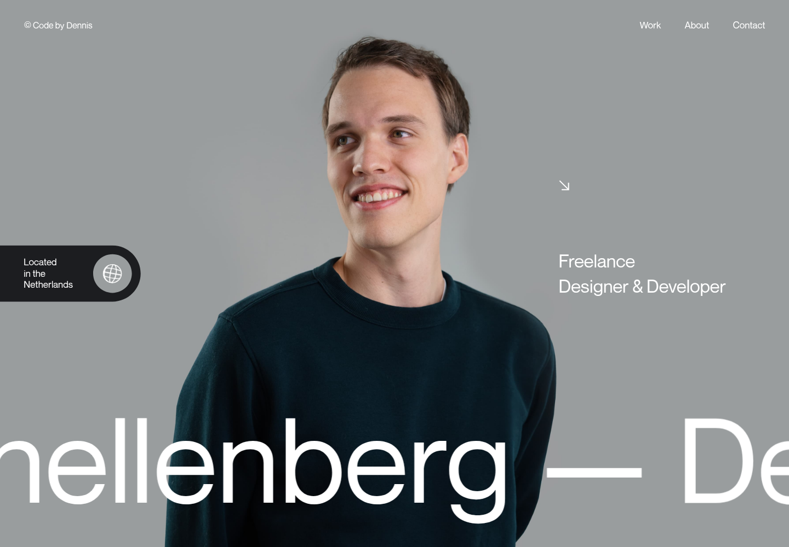
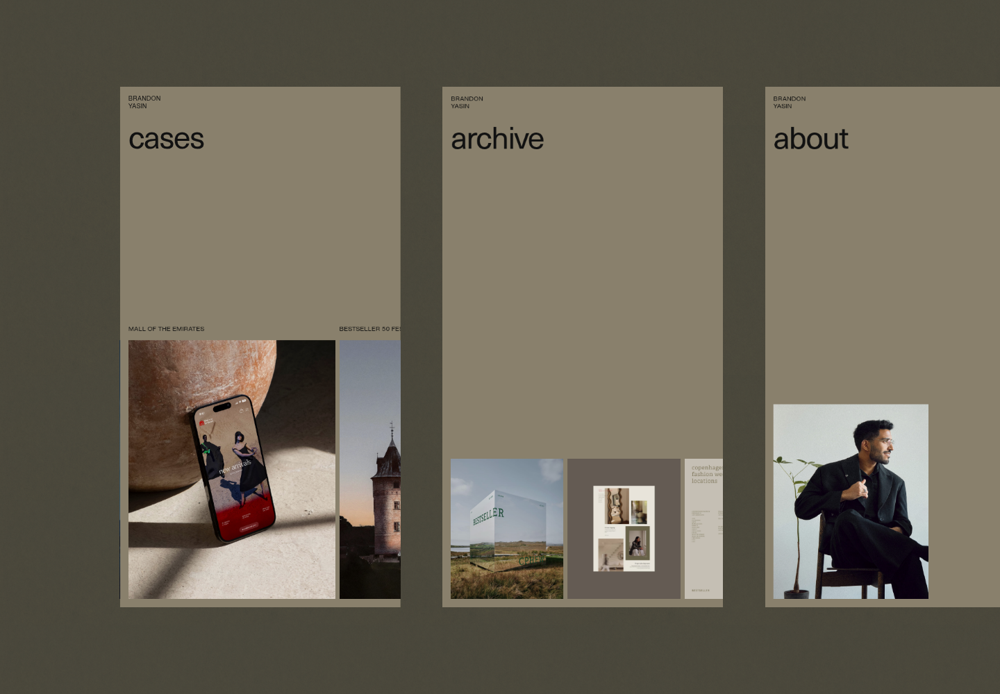
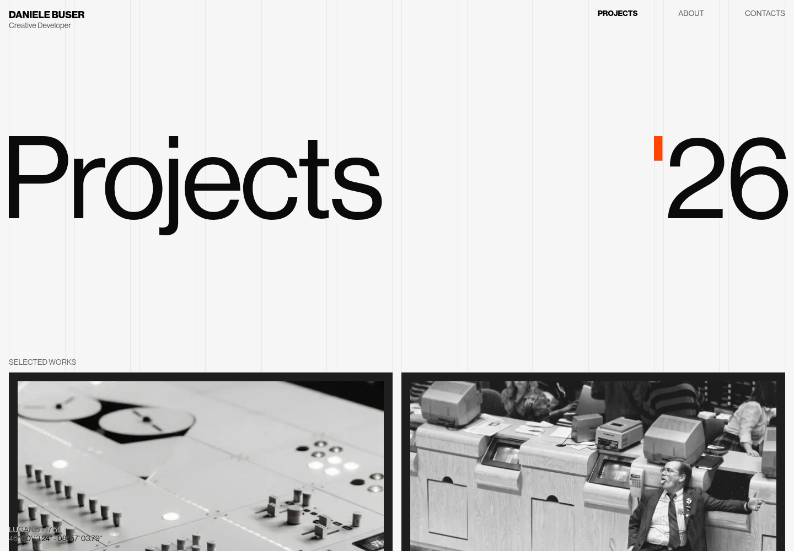

# Awwwards reference study

## Source and selection

Browsed Awwwards.com portfolio and minimal collections, opened the submitted sites, and inspected their live layouts and interactions on 30 October 2026. The following three guide the replacement for the rejected V2 draft.

### Dennis Snellenberg

[Awwwards listing](https://www.awwwards.com/sites/dennis-snellenberg) / [live site](https://dennissnellenberg.com/)

Observed: portrait fills the opening rather than sitting in a small card; identity and role occupy different scales; enormous typography crosses the image; the controls stay quiet. The photograph does the personal-brand work. Do not reproduce the original's scrolling implementation.

Adopt for AY: a portrait-led opening, large direct Executive Assistant identity, compact supporting copy, and generous photographic surfaces. The supplied portrait is a design placeholder and remains credited.

### Brandon Yasin

[Awwwards listing](https://www.awwwards.com/sites/brandon-yasin) / [live site](https://brandonyasin.com/)

Observed: opening composition uses overlapping image crops; menu unfolds the routes into tall page covers; shared surfaces and carefully paced transitions make navigation part of the visual identity. Inspected the menu open state and its actual links.

Adopt for AY: an editorial page index with oversized route labels and a corresponding image; coordinated menu opening and route entry, ordinary Next.js routes underneath. Retain direct navigation for frequent tasks. No time-travel feature, sound, simulated desktop or horizontal page navigation.

### Daniele Buser

[Awwwards listing](https://www.awwwards.com/sites/danilele-buser-portfolio) / [live site](https://www.danielebuser.com/)

Observed: very large Projects title, sparse metadata, large monochrome work images, minimal navigation and a direct email close. The composition has impact before any animation. This is an Awwwards-listed submission; no award is claimed here.

Adopt for AY: large page subjects, a spare case-study index, generous image scale and disciplined text lengths. Do not copy the decorative column guides or developer-specific content.

## Revised direction: AY, the executive edit

- Silver canvas #e9e9e6, charcoal #252725, paper #f9f9f6, stone #d2d3cd, cobalt #3040ce, secondary text #62655f.
- Instrument Sans. Large display text is medium weight, tightly spaced and carefully broken; body copy stays open and short.
- Home opens with AY's role and a large portrait composition. Editorial support index, selected scenarios and a short personal introduction follow.
- Services becomes an open service index with large titles and visible scope. Remove the small tinted aside and accordion-led layout.
- Work uses large photographic covers and concise context; detail pages show the thinking and a sample handoff.
- About combines a strong portrait crop with executive judgment and working practices.
- Toolkit connects tools to their actual workflow; credentials remain honest until client evidence is supplied.
- The menu is a designed index, with real links and native dialog focus behaviour.
- One authored opening sequence; motion responds to navigation and deliberate selection. Native scrolling, no Lenis, no pinning, no 3D and no sound.

## Check against the brief

The rejected layout resembled a service landing-page template. This direction takes its scale, photographic presence, navigation concept and work presentation from the three observed references. The actual content stays specific to executive assistance. It must work as a still composition before animation is added.

## Plan

1. Complete: shared presentation, portrait-led home, editorial menu and open services index.
2. Complete: about, work index, three case-study detail pages, toolkit, credentials and contact.
3. Complete: browser inspection, keyboard and reduced-motion checks, lint, type and production build checks.

## Delivery evidence

- `pnpm lint`, `pnpm check-types`, `pnpm build` and `git diff --check` passed after the final source changes.
- Ten routes returned HTTP 200 at 320, 768 and 1440px. No horizontal overflow was observed in those 30 route/viewport combinations.
- A fresh browser session recorded no console warnings, console errors or page exceptions during the final route pass.
- Menu opens as a native modal dialog. Escape closes it, restores the Menu trigger focus and releases the body scroll lock.
- Reduced-motion preference leaves headings unsplit and removes spatial motion. Native wheel scrolling moved the document normally; computed scroll behaviour is `auto`.
- Contact prepares an email draft, focuses the review, preserves details when edited and returns focus to the name input. No message was sent.
- With JavaScript disabled, the role heading and footer navigation remain available, and contact has a direct email/native email-form fallback.
- The unknown-page route returned HTTP 404 and displayed the portfolio's recovery links.
- The streamed-page hydration issue was resolved by placing heading and photograph motion inside components that own their DOM. The case-study route has its own loading boundary for Partial Prefetching.

## Preview status

Changes remain on `v2`. The portrait and email are authorised placeholders; scenarios and documents are illustrative. No client results, testimonials or certificates were invented. Production hosting and AY's actual biography, portrait, address and evidence are outside this design iteration.
